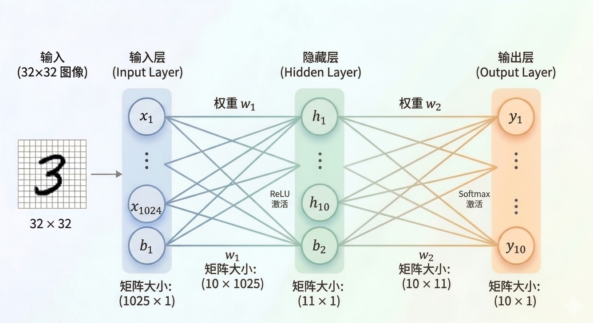
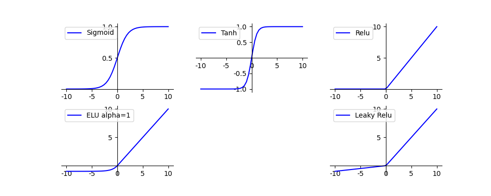
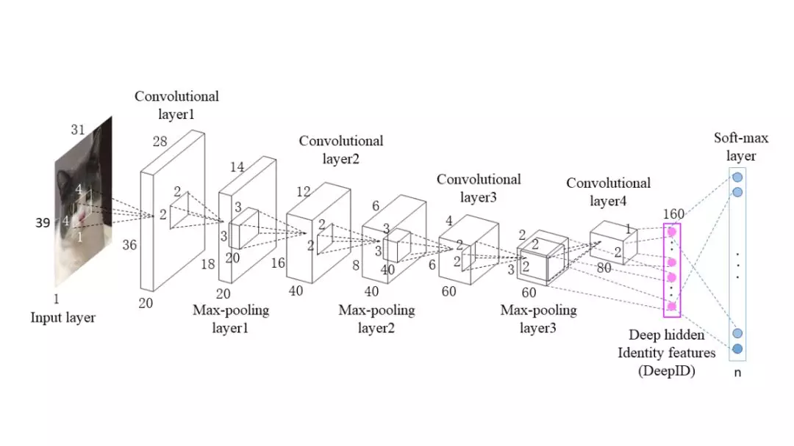
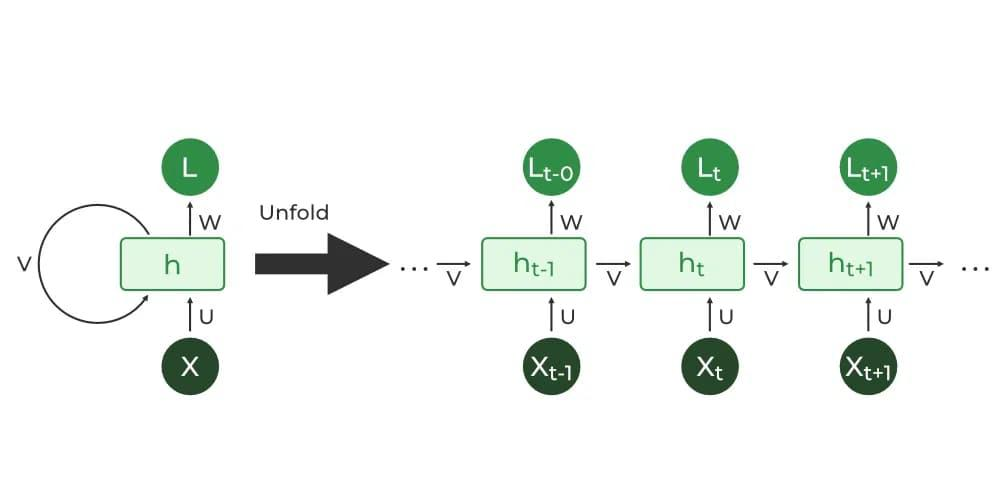

# 绪论

写这篇文的起因是前几天和一位学弟吃饭，他提到读研想做LLM方向，却苦于不知道从何入门。我随口问他目前在学些什么，结果他说还在从头死磕《西瓜书》。这让我多少有些感慨与无奈。

诚然，无论从事AI的哪个方向，都需要具备坚实的数理基础并了解底层逻辑。但考虑到机器学习和深度学习已经发展了这么多年，就连Transformer也快是十年前的产物了。如果此时还完全遵循网上的传统路线，从经典机器学习的基础一路学起，内容量未免过于庞大。更不用提LLM是一个几个月就发生一次技术迭代的前沿领域，如果按部就班地学下去，恐怕很难赶上第一梯队的进度。

因此，在2026年这个时间节点，我认为更高效的学习路径是：先对AI的发展史建立一个宏观的框架认知，对经典的神经网络及其层级架构（例如 CNN、RNN）浅尝辄止即可。把核心精力聚焦于大模型绕不开的关键技术，如Transformer、Attention机制、Agent、RL等领域进行深度钻研，遇到不熟悉的基础概念时再按需回溯。

基于此，我计划推出一个完整的博客系列：前期简述Transformer之前的前置知识，后续重点剖析Tokenization、Transformer、Attention机制，以及大模型的量化、蒸馏、微调调优（SFT），最后延伸到强化学习。整个系列的演进逻辑与斯坦福的CS336课程大致契合。这也是我极力推荐的一门课程，如果时间允许，建议每位想入门大模型的同学都能在不依赖AI的情况下，自己动手完成CS336的作业。不求每一行代码都亲自手敲，但最起码要深刻理解每一步背后的原理，而不是单纯地Vibe Coding。相关的代码实现我也会同步更新在我的GitHub仓库中。

::github{repo="kakieccc/cs336_homework"}

这篇博客是该系列的首篇，我将带大家从早期的规则系统出发，快速串讲至CNN与RNN，为大家构建一个必要的前置知识网络。

# 早期的规则学习

在机器学习这个概念还没有被提出时，人工智能基本只能基于规则实现。例如识别垃圾邮件和广告，就需要把垃圾邮件可能包含的所有关键词都给写出来。显然，对于这种基于规则的建模，它的智能程度严格和工程师写的规则挂钩，可以说其实具备了一定的“智能”，但十分有限。

# 机器学习

在神经网络还没有普及之前，早期的机器学习主要解决的是分类、回归、数据的聚类和降维以及异常数据检测这几类问题。

| 问题类型 | 描述                                       | 常用经典算法               |
| -------- | ------------------------------------------ | -------------------------- |
| 二分类   | 将数据分为两个互斥的类别（是/否）。        | 逻辑回归、SVM (支持向量机) |
| 多分类   | 将数据分到多个预定义的标签中。             | 决策树、朴素贝叶斯         |
| 数值回归 | 预测一个连续的数值，而不是类别。           | 线性回归、岭回归           |
| 聚类分析 | 在没有标签的情况下，把相似的东西堆在一起。 | K-means、层次聚类          |
| 降维     | 把成千上万个特征压缩成几个核心特征。       | PCA、LDA                   |
| 关联规则 | 发现不同物品之间“同时出现”的概率。         | Apriori算法               |

这几类问题又可以根据是否有答案分为监督学习和无监督学习。

监督学习指的是收集的数据本身是带有标签和答案的。例如房价预测问题，已知的信息同时包括楼房大小、地段、楼层等特征信息以及它对应的价格，其中各种特征信息就是标签，价格就是答案。对于监督学习，我们要做的是通过学习，预测某种特定特征下的答案。由于我们是知道答案的真实值的，所以可以求出一个误差`预测值-真实值`。这个误差也被称为loss,监督学习的最终目的就是去最小化误差，误差越小说明预测的越精准。分类和回归问题都是经典的监督学习。

无监督学习指的是收集的数据是没有答案（标签）的。比较典型的问题包括聚类、降维问题以及关联规则挖掘。在无监督学习中，我们需要根据数据已有的特征进行学习，去寻找不同数据之间的内在模式和关联。这主要依赖数据本身的数学特性（例如距离、方差分布等）来实现。

请注意，强化学习并不属于监督学习和无监督学习的任何一种。强化学习是以奖励为导向的，它和监督学习、无监督学习是并列关系而非包含关系。广义上来说，机器学习是一个大的统称，泛指一切让计算机进行学习获得答案的方法。深度学习、强化学习都被它包含在其中。

早期的机器学习仍然是算法为主导的，从海量的数据中进行学习，预测合理的输出。它虽然已具备一定的智能，但存在很大的局限性，也就是只能处理结构化的数据。为此需要进一步的拓展，也就诞生了神经网络和深度学习。

# 深度学习与神经网络

早期机器学习的很多思想对后来的神经网络起了基石的作用。例如感知机、激活函数等等：

| 神经网络概念 | 启发来源             | 演进逻辑                                                     |
| ------------ | -------------------- | ------------------------------------------------------------ |
| 神经元节点   | 感知机               | 早期感知机就是最简单的神经元：输入 × 权重 + 偏置。           |
| 激活函数     | 逻辑回归             | 逻辑回归使用的 Sigmoid 函数，直接成为了早期神经网络最核心的激活函数。 |
| 损失函数     | 线性回归 / 逻辑回归  | 最小二乘法（MSE）和交叉熵（Cross-Entropy）全是早期统计学习的产物。 |
| 权重更新     | 线性模型中的梯度下降 | 早期算法通过微积分找最优解的思想，演变成了现在的反向传播 (BP)。 |

## 神经网络

上文中已经提到，传统的机器学习只支持结构化数据，对于图片、音频等数据，需要自己手动提取特征信息并转换成结构化数据。这样不仅麻烦而且特征信息提取不全面。为此设计出了神经网络，让机器自己去进行特征信息的提取。

如图是一个经典的神经网络示意图，可以分为三个部分，分别是输入层，隐藏层，输出层。

神经网络的本质是一个极其复杂的复合数学函数。它的核心任务是将输入数据通过一系列非线性变换，映射到我们想要的输出结果上。

神经网络得到结果的过程叫前向传播，主要靠两个数学动作：

- 加权求和：每个神经元会接收来自上一层的所有信号。每个信号都有一个权重 ($w$)，代表该信息的重要性。

- 激活函数：如果只有加权求和，神经网络就只是一个复杂的线性公式。激活函数（如ReLU, Sigmoid） 的加入，给模型引入了非线性变换的能力。

神经网络之所以能得到结果，是因为它通过隐藏层将凌乱的原始输入，一步步重构成高密度的特征表示；再通过权重训练，找到了从特征到答案的那条最优数学路径。

### 输入层

计算机是无法直接输入图像等数据的，需要将其转换成对应的数值矩阵。输入层的元素维度与输入量的特征息息相关，例如输入一张$32 \times 32$像素的灰度图像，那么输入层的维度就是$32 \times 32 = 1024$，为了处理偏置，通常添加一个常数1作为第1025维。

### 输入层到隐藏层

输入层到隐藏层是经过一个矩阵计算：
$$
H = W_1 \times X + b_1
$$
这里$W_1$的大小为$10\times1025$，10代表隐藏层有10个神经元，1025是输入向量的长度。相乘后得到一个$10\times1$的$H$向量。

### 隐藏层到输出层

隐藏层到输出层同样是经过相同的矩阵计算：
$$
Y = W_2 \times H + b_2
$$
隐藏层矩阵输出10个神经元，加上1个偏置项，矩阵维度变为$11\times1$。$W_2$的大小为$10\times11$，10代表输出层有10个类别（对应数字0-9），11代表隐藏层传入的向量长度。

### 激活函数

一系列线性方程的运算最后都可以化简成一个线性方程，激活函数就是为矩阵运算的结果添加非线性的，否则增加神经网络的深度（层数）将毫无意义，因为最终都能化简为一层。

每个隐藏层计算之后，都需要加一层激活层，要不然该层线性计算是没有意义的。

常见的激活函数包括阶跃、Sigmoid、ReLU等。这里不再展开说明，可以自行查阅。

### 归一化处理 (Softmax)

最后输出的结果矩阵 $Y$ 代表了各个类别的得分，我们可以直接寻找其中的最大值来确定对应的分类，但这缺乏良好的概率意义，不够直观。因此我们通常会引入 Softmax 函数，将这些得分转换为每一类对应的概率分布。Softmax函数的公式如下：
$$
\text{Softmax}(z_i) = \frac{e^{z_i}}{\sum_{j=1}^{K} e^{z_j}}
$$

最后得到的是一个矩阵，每个元素表示对应分类的概率，它们的和为1。

### 损失函数

通过Softmax层之后，我们得到了每一类别分别对应的概率，但是要注意，这是神经网络计算得到的概率值结果，而非真实的情况。二者之间是有差距的，一个优秀的网络对结果的预测要无限接近于100%，为此，我们需要将Softmax输出结果的好坏程度做一个量化。

一种方法是求概率的对数的负数。概率越接近100%，该计算结果值越接近于0，说明结果越准确，该输出叫做交叉熵损失。
$$
L = -\sum_{i=1}^{K} y_i \log(p_i)
$$
我们训练神经网络的目的，就是尽可能地减少这个loss。

### 反向传播

上一节提到，训练神经网络的核心目的就是尽可能地最小化损失 (Loss)。这一目标可以通过不断迭代、优化网络中的权重 $w$ 和偏置 $b$ 来实现。而更新权重的核心机制，正是基于微积分中链式法则的反向传播算法 (Backpropagation)。有关反向传播的详细数学推导，读者可以查阅相关的专业资料做进一步探索。

## 深度学习

当神经网络的深度不断加深时，会面临梯度爆炸和梯度消失的问题，导致深层网络难以有效训练。深度学习正是在克服这些挑战的基础上发展而来。为了解决梯度问题，研究者们提出了一系列关键技术：使用ReLU等改进的激活函数替代Sigmoid、引入批正规化稳定训练、采用残差连接允许梯度直接传播、以及改进权重初始化方法。这些创新使得训练更深的网络成为可能，从而诞生了CNN、RNN、ResNet、LSTM等深度网络架构，在图像识别、自然语言处理等领域取得了突破性的进展。由于本文主要是面向LLM方向，因此只会对CNN和RNN进行简要介绍。

### CNN（卷积神经网络）

CNN的设计初衷是为了更好地处理具有空间结构的数据（如图像）。与传统神经网络不同，CNN利用卷积操作来自动学习图像的空间特征。

卷积操作的核心思想是：用一个小的滑动窗口（称为卷积核或过滤器）扫过图像，在每个位置进行点积运算，得到一个特征图。通过多个不同的卷积核，网络可以学到图像中的不同特征，例如边界、纹理、形状等。

卷积层之后通常跟一个池化层，其作用是对特征图进行下采样（例如取最大值），一方面减少参数量，另一方面增强模型对图像平移的容错能力。

一个典型的CNN架构如下：输入图像 → 多个卷积层 + 池化层交替 → 展平 (Flatten) → 全连接层 → 输出。通过这样的巧妙设计，CNN 能够有效地从图像中提取出层次分明的特征：浅层网络学到低级别特征（如边缘、基础纹理），深层网络学到高级别特征（如具体的物体部件）。这也是为什么 CNN 在图像分类、目标检测等视觉任务上表现优异的关键原因。

### RNN（循环神经网络）

如果说CNN专门为处理空间数据设计，那么RNN则是为了处理时序数据（如文本、语音、时间序列）而设计的。

普通的神经网络是无记忆的——每次输入都是独立处理，无法捕捉序列中的前后关系。而RNN通过引入循环连接，让网络具备记忆能力。具体来说，RNN在每个时刻$t$的隐藏状态$h_t$不仅取决于当前输入$x_t$，还取决于上一时刻的隐藏状态$h_{t-1}$：

$$
h_t = \sigma(W_{hh} h_{t-1} + W_{xh} x_t + b_h)
$$

这样，网络可以在时间维度上传递信息，从而"记住"序列中的历史信息。

然而，最原始的RNN存在一个严重问题：梯度消失。当反向传播经过很多时刻时，梯度会逐步衰减，导致网络无法学到长期依赖关系。为了解决这个问题，研究者提出了LSTM（长短期记忆网络）。

LSTM引入了一个巧妙的设计：用门机制（遗忘门、输入门、输出门）来控制信息的流动，允许网络更好地保留重要信息并遗忘无关信息。LSTM的出现使得RNN能够有效处理具有长期依赖关系的序列问题，成为自然语言处理领域的基础架构，直到Transformer的出现。
