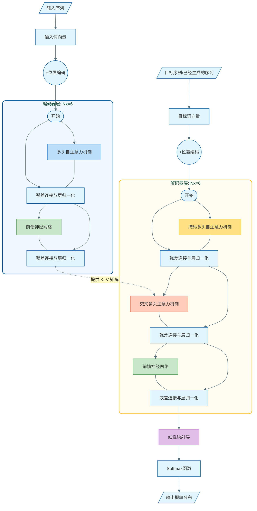
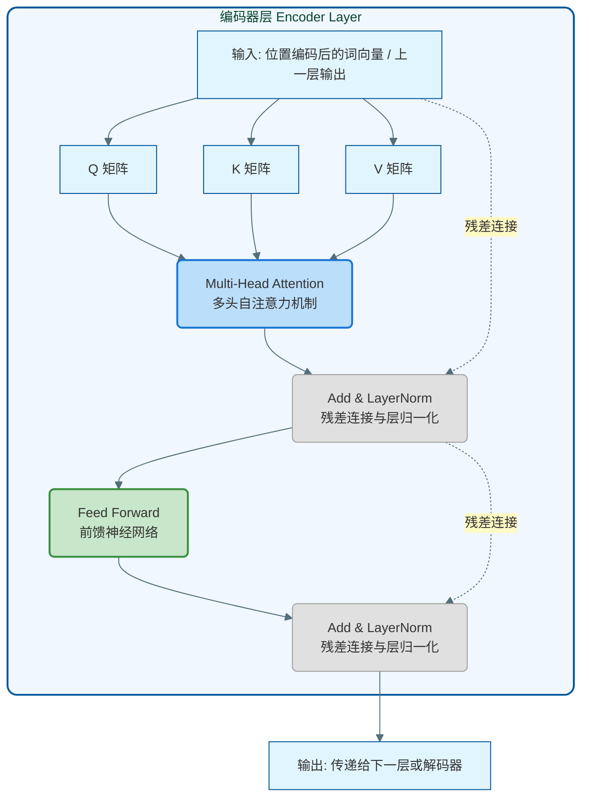
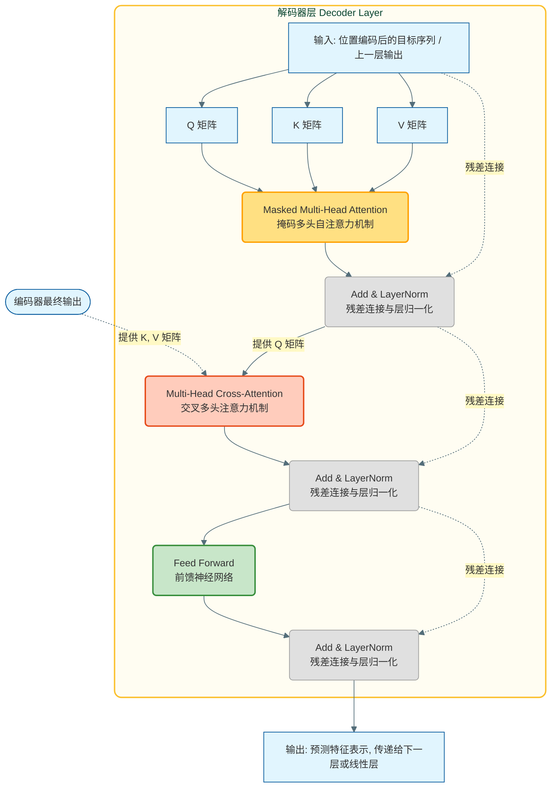
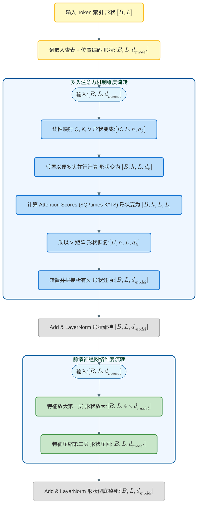

# Attention

## CNN与RNN处理文本序列

绝大多数人在第一次接触深度学习处理NLP任务时，都是从词向量开始的。模型无法直接阅读文字，所以第一步是查表，把输入的一个词、一句话变成一组数字（多维向量）。这个向量在模型空间里捕捉了该词的语义特征，比如“国王”和“男人”在某个维度上可能高度相似。

早期，人们尝试用图像领域的CNN和专门处理序列的RNN来解决文本问题：

- CNN的局限： CNN通过一个固定大小的卷积核扫过句子，每次只能看到相邻的几个词。如果想理解相隔很远的两个词的关系，就需要堆叠非常深的卷积层。这种“局部视野”天然不适合长文本。
- RNN的局限： RNN似乎天生就是为文本设计，像人类阅读一样从左到右逐词读取，每读一个词就把信息和之前的“记忆”结合。但RNN有两个致命弱点：
  1. 长程遗忘问题：当句子很长时，早期的信息在经过多次循环传递后会被稀释或覆盖。虽然LSTM和GRU引入了“门控机制”来挑选重要信息，但在超长文本面前依然极易丢失细节。
  2. 无法并行计算：因为必须排队“读完上一个词，才能处理下一个词”，时序依赖导致RNN的计算极慢，无法充分利用现代GPU的强大并行算力。

## Attention的直觉

Transformer 彻底抛弃了 RNN 的顺序结构，它的做法非常直接：让句子里的每一个词，都去和句子里的所有其他词直接看一眼，然后自己判断自己和谁最相关。相关的词多分配一点注意力，无关的词少分配一点。这模拟了人类阅读时的“选择性关注”，距离不再是问题，因为任何两个词之间的距离在 Attention 中都是 1。

举个例子：
> "The animal didn't cross the street because **it** was too tired."（那只动物没有过马路，因为**它**太累了。）

当我们要理解这里的 "it" 指代什么时，Attention 机制会让 "it" 去观察这句话里的所有词。经过计算，"it" 会发现自己和 "animal" 的相关度最高，而不是 "street"。如果是 "because it was too wide"，"it" 的注意力则会集中在 "street" 上。这就是自注意力机制的强大之处——动态地根据上下文改变词的具体含义。

## 如何衡量两个词的相关性？

既然要让词和词互相观察，我们需要一种数学工具衡量相关度。Transformer 选了最高效的一种：向量点积。

在向量空间中，点积天然是一个衡量“方向一致性”的指标，而“方向一致”在 Embedding 空间里就等价于“语义相关”。
回顾点积的几何逻辑：
$$
\mathbf{x} \cdot \mathbf{y} = \|\mathbf{x}\| \|\mathbf{y}\| \cos \theta
$$
- 如果两个词语义相关（方向接近），夹角 $\theta$ 小，点积很大。
- 如果毫无关系（夹角正交），点积接近 0。
- 如果语义相反，点积为负。

更重要的是，在硬件层面，点积本质就是矩阵乘法。现代 GPU/TPU 对矩阵乘法有着极致的设计优化，点积的高计算强度能充分填满 GPU 单次时钟周期的并行计算单元，这是 Transformer 能够高效利用算力的基础。

## Q、K、V 的引入

仅仅拿原始的词向量直接去互相算点积虽然直观，但在处理自然语言的句法逻辑时会遇到两个致命的缺陷：

1. 注意力变成了绝对对称的（$v_A \cdot v_B = v_B \cdot v_A$）：这意味着词 A 对词 B 的“关注度”，永远等于词 B 对词 A 的“关注度”。但在真实语言中，词与词的关系通常是不对称的。比如在“吃苹果”中，“吃”非常需要去关注“苹果”这个动作对象，但“苹果”在当前语境下可能更需要去关注前面的主语是谁。强制对称会扼杀掉语言的方向依赖与主从关系。
2. 自己永远最关注自己（$v_A \cdot v_A = \|v_A\|^2$）：一个向量与自身的点积是自身的模长平方，这在数值计算上通常会拿到最大的分数。这意味着如果直接用原词向量算分数，每个词经过 Softmax 后都会把压倒性的注意力分配给自己，从而流失了去关注其它上下文的机会。而“结合上下文信息”恰恰是使用 Attention 的根本目的。

为了打破这种局限，Transformer通过三个独立可学习的权重矩阵（$W^Q, W^K, W^V$）对原词向量分别做线性映射，从而得到：

- Q（Query，查询）：代表当前词在“寻找”什么样的上下文信息。
- K（Key，键）：代表当前词“具备”什么样的特征，用来吸引并响应别人的查询。
- V（Value，值）：代表当前词的“核心语义/本质内容”，是最终被挑选出来打包传递出去的真实信息。

举个例子：
>想象你去图书馆找数据结构的书。你在检索系统里输入了“树、图、算法”（这就是你的 Q）。图书馆里每一本书的封面上都有书名和标签分类（这就是书的 K）。系统会计算你的 Q 和所有书的 K 的匹配程度。一旦找到了得分最高的那本书，你就会翻开它，提取阅读它里面的知识正文（这就是书的 V）。

有了 Q、K、V，Attention从最初死板的特征匹配，一跃成为了一个高度动态的的信息检索黑盒。

## 缩放点积注意力

Transformer 的完整操作，被浓缩在这条经典公式中：
$$
\text{Attention}(Q, K, V) = \text{softmax}\left(\frac{QK^T}{\sqrt{d_k}}\right)V
$$
这个过程拆解开来，其实就是以下四个步骤：

1. 向量点积

首先，当前词派出的Q向量，依次去和句子里所有词（甚至包括它自己的） K 向量计算点积。
运算的结果构成了一个巨大的相关性的实数打分矩阵（Attention Scores）。分越高，彼此之间的吸引力和“关注度”就越深。得益于矩阵乘法$Q K^T$，这一步其实是无数词两两之间一瞬间并行算完的。

2. 除以缩放因子

强行除以 $\sqrt{d_k}$是为了防止梯度消失这类灾难。随着特征维度的增加，独立随机变量进行点积相加后，结果的方差也会随之被放大$d_k$倍。这意味着未经干预的点积绝对值非常容易“爆掉”变成极大数或极小数。
如果直接把极大极小的常数丢入下一步的 Softmax 里，Softmax 立刻会变得非常极端：它会将最大的分数值直接推升向概率1，其余全碾压至0。函数曲线此时处于平坦的饱和区，导致在反向传播时梯度几乎逼近零。除以 $\sqrt{d_k}$ 是一次完美的退火尺度变换，把点积强行压平拉回到均值为0，方差为1的安全带，确保了模型训练初期的稳步收敛。

3. 概率归一化

得到被精修过的打分矩阵后，套上一层归一化的Softmax函数。
Softmax 将原本散乱、无界的实数打分，平滑压缩到一个全部介于$[0, 1]$ 之间、且每行总和为1的全局概率分布中。
这组概率就是注意力权重。它量化出这一刻你在解读这句语境的过程中，到底该把百分之几的心血分给哪些词。

4. 加权求和

最后，用刚才算出的百分百占比权重，乘以上下文里每一个词携带了真实内容的V向量并相加：
- 某个词一旦跟你的Q高度吻合（权重接近1），它的V向量将被你吸收进你的新表征中。
- 某个词若全然无关（权重接近0），它的V内容便会被抹除。
- 大多部分处于中间态权重的词，也会按比例贡献属于它们的只言片语。

随着这一整套操作运行完毕，输出的全新向量就变成了一个融合当前整段全局上下文信息的混合体。

# Transformer架构

在了解了注意力机制后，我们可以正式开始学习Transformer了。请注意，Attention并不是Transformer提出的，早在使用RNN时就有学者尝试将Attention加入到网络中。Transformer所提出的是多头注意力（Multi-head Attention）机制。

## 自注意力机制与多头注意力

前文所解释的Attention原理在Transformer中主要以自注意力的形式存在。
早期的Attention多数发生在两段不同的文本之间（如机器翻译中，解码器作为Q去查询编码器作为K和V）。而在自注意力中，Q、K、V 全部来自同一序列。这允许句子内部的每一个词都相互建立联系，从而直接解决词法依存和指代消解等问题。

为了进一步提升这种机制的特征捕捉能力，Transformer引入了多头注意力。
如果仅仅使用一组 Q、K、V 进行计算，模型往往只能捕获单一维度的语义特征。多头注意力的做法是：并行设置多套独立的 $W^Q$、$W^K$、$W^V$ 权重矩阵（原论文中设置了8个“头”）。

执行过程如下：

1. 输入向量被不同的权重矩阵分别映射到不同的低维子空间中。
2. 每个头在自己的子空间内独立运行一遍 Scaled Dot-Product Attention。
3. 把所有头算出的输出向量在特征维度上拼接在一起，再通过一个线性映射矩阵降维融合为最终输出。

多头机制赋予了模型在不同特征子空间中同步学习的能力（例如有的头关注语法结构，有的头捕捉时态倒装，有的头关联实体指代），有效拓宽了模型理解文本的维度。

## Transformer网络结构

Transformer整体采用标准的Encoder-Decoder架构。
编码器负责读取并理解输入序列，将其转换为包含全局信息的特征向量。解码器负责根据编码器的输出以及历史生成的词汇，逐个预测下一个词。

在输入网络之前，文本不仅会被转换为词向量，还会被加上位置编码。因为Attention机制本身没有任何顺序概念，位置编码的作用是把词在句子中的绝对或相对位置信息叠加到词向量上，让模型能够区分词的先后顺序。

## 编码器

编码器的核心作用是提取输入序列的全局语义特征。它将离散的词汇输入转化为包含丰富上下文关系的连续稠密向量表示。

**输入**：对于第一层编码器，输入是原始文本的词向量与位置编码的相加结果。对于后续的高层编码器，输入则是上一层编码器的输出向量。
**输出**：每一层都会输出一组与输入等长、等维度的向量序列。最后一层编码器输出的向量序列包含了整个输入句子的终极上下文特征，这些特征将作为K和 V全盘传递给解码器。

编码器由6个结构完全相同的基础层堆叠组成。每一层内部包含两个核心子层：
1. 多头自注意力层：负责让句子中的词互相交互，提取上下文特征。
2. 前馈神经网络：对注意力层提取出的特征进行非线性变换和维度扩展。

在每个子层外部，Transformer都加入了残差连接和层归一化。公式表示为 `LayerNorm(x + Sublayer(x))`。
残差连接允许原始输入信息直接跳过当前层向后传递，防止深层网络出现梯度消失。层归一化则用于抹平不同特征间的数值差异，保证数据分布的稳定，加速训练收敛。

## 解码器

解码器的核心作用是自回归生成。它基于编码器提供的全句上下文特征，以及当前已经生成的词，去预测下一个最可能出现的词。

**输入**：解码器的输入包含两部分。一部分是目标序列（已经生成的词汇）加上位置编码（类似于编码器的输入）；另一部分则是来自编码器最后层输出的特征矩阵。
**输出**：最后一层解码器输出的特征表示，会进入一个线性映射层，再通过 Softmax 函数转化为词表中所有词的概率分布，概率最大的词即为本次预测的输出结果。

解码器同样由6个相同的层堆叠而成。每一层包含三个子层。除了和编码器相同的自注意力层与前馈网络层外，多出了一个交叉注意力层：

1. 掩码多头自注意力：在生成文本时，由于未来的词还没生成，模型只能看到当前及之前生成的词。掩码的作用是把当前位置之后的词汇强制遮蔽（将其在注意力打分矩阵中的分数设为极小值），确保预测过程不发生“未来信息泄露”。
2. 交叉注意力：这是解码器获取原始输入信息的唯一结构。此时，Q 矩阵来自解码器的上一层输出，而 K 和 V 矩阵来自编码器的最终层输出。解码器通过自己的查询向量 Q，去编码器提取好的结果（K 和 V）中检索需要的信息。
3. 前馈神经网络：与编码器中的作用一致。

解码器的最终输出会拼接一个线性映射层和Softmax函数，从而计算出下一个词在整个系统词表中的概率分布。

## 输入与输出的维度变化

在理解了整体架构后，如果能理清数据在模型中流转时的形状变化，对代码实现和底层逻辑会有极其深刻的认识。

为了方便推演，我们先统一下文将要用到的核心维度参数及其物理意义：

- $B$ (Batch Size，批次大小)：模型在一次前向传播中同时并行处理的序列（句子）数量。
- $L$ (Sequence Length，序列长度)：输入文本序列中包含的 Token（词汇）的最大数量。
- $d_{model}$ (模型维度/词嵌入维度)：模型内部用来表示一个 Token 的特征向量的长度。$d_{model}$ 越大，模型能同时容纳和提取的上下文语义、句法等特征就越丰富，模型的学习能力（及体积参数量）也就越庞大。
- $h$ (Number of Heads，注意力头数)：多头注意力机制中独立并行的“注意力头”的数量。
- $d_k, d_v$ (子空间特征维度)：每个注意力头被分派到的处理维度，通常 $d_k = d_v = d_{model} / h$。

### 输入阶段

- 原始输入：经过 Tokenizer 处理后，输入变成形状为 $[B, L]$ 的整数索引矩阵。
- 词嵌入与位置编码：查表后维度扩展为 $[B, L, d_{model}]$。加上位置编码后形状保持不变，依然是 $[B, L, d_{model}]$。

### 多头注意力计算

- 线性映射：输入在这个阶段分别乘上 $W^Q, W^K, W^V$ 矩阵，虽然逻辑上被切分给 $h$ 个头，但在代码实现中，通常先把形状变为 $[B, L, h, d_k]$，然后转置为 $[B, h, L, d_k]$ 以便并行计算点积。
- 点积打分：$Q$ 和 $K^T$ 相乘得出 Attention Scores，形状为 $[B, h, L, L]$。这代表了每个头下，$L$ 个词两两之间的注意力权重。
- 乘上V：打分矩阵再乘以 $V$（形状 $[B, h, L, d_v]$），结果恢复为 $[B, h, L, d_v]$。转置并重新打包拼接后，还原回 $[B, L, d_{model}]$。
- 经过残差连接和 Layer Normalization 后，形状依然死死锁在 $[B, L, d_{model}]$。

### 前馈神经网络 (FFN)

- FFN 通常包含两个线性层，中间夹着 ReLU 或 GELU 激活函数。为了增强非线性表达能力，第一层通常会把特征维度放大 4 倍（即 $4 \times d_{model}$），形状变为 $[B, L, 4 \times d_{model}]$。
- 第二层再把它压缩回 $[B, L, d_{model}]$。
- 再次经过残差连接和 Layer Normalization，输出仍是 $[B, L, d_{model}]$。

整个编码器或解码器无论堆叠多少层，输入输出的 Shape 始终如一（都是 $[B, L, d_{model}]$），这正是模块化设计的完美体现，也是能够无限堆叠残差模块的先决条件。

## 训练与推理时的核心区别

Transformer 最神奇的地方之一在于，它的解码器在训练和推理时，工作模式有着天壤之别。这也常常是很多初学者最容易迷惑的地方。

训练阶段：“上帝视角”下的并行计算 (Teacher Forcing)

在训练时，模型其实是完全知道正确答案（即目标序列）的。
- 编码器一次性看完全部输入序列，产出全局特征向量 K 和 V。
- 解码器并不需要像人说话一样一个词一个词往外蹦。我们直接把完整的、向右平移一位的目标序列一次性喂给解码器
- 掩码（Mask）的作用：在解码器的自注意力层里，为了防止位于位置 $t$ 的词“作弊”偷看到 $t+1$ 的正确答案，我们加上了一个下三角掩码矩阵（将未来信息的分数设为 $-\infty$）。
- 由于一切都在巨大的矩阵里准备好了，GPU 可以一瞬间并行算完整个序列每一个位置的预测概率，极大地发挥了硬件优势。这种把部分正确答案直接塞给输入去预测下一个词的做法叫做 Teacher Forcing。

推理阶段：自回归生成

在真实使用模型时，它并没有所谓的“标准目标答案”可以参考，一切只能靠自己。
- 编码器依然是一次性处理完用户的 Prompt（输入序列），产出 K 和 V，这部分保持不变。
- 解码器则完全退化为自回归（Auto-Regressive）模型，只能单步循环执行：
  1. 第一步，解码器只接收一个起始符 `<START>`，结合编码器的信息，预测出第一个词。
  2. 第二步，把刚才生成的第一个词拼接到输入中，也就是喂给解码器 `<START>` + `词1`，预测出第二个词。
  3. 第三步，喂给解码器 `<START>` + `词1` + `词2`，去预测第三个词……
- 以此类推，直到模型预测出终止符 `<END>`。
- 因为每生成一个新词，都要把之前所有的历史生成结果重新参与一次运算（虽然现在的工程实现中引入了 KV Cache 优化来避免注意力矩阵的重复计算，但整体逻辑依然是串行的），所以推理速度远远慢于训练速度。这也解释了为什么如今我们在使用大语言模型（LLM）时，它的回复总有那种“逐字敲击”的流式输出感。

总结来说，训练时 Transformer 利用 Mask 机制实现了时间维度的恐怖并行，而推理时则受限于因果逻辑，只能退回顺序生成。这构成了 Transformer 体系中最迷人的一组矛盾统一体。

# 现代大模型的架构演进

## 从 Post-Norm 到 Pre-Norm

在原始的 Transformer 中，层归一化（LayerNorm，用来把数据收拾平整的操作）是放在每一步计算之后的，这叫 Post-Norm。

这就像是在传递信息的高速主干道上，每经过一个小镇就设一个“重新洗牌整理”的安检站。当网络只有几层时还没事，但当网络堆到几十上百层时，最初始的信号经过层层安检早已经被过滤得面目全非。这也导致了原始模型在训练初期极其不稳定，非常容易发生梯度消失（也就是不管怎么训练模型都不变聪明）或者梯度爆炸问题。

聪明的科学家把归一化操作全拔了出来，放进了旁边的子干道（在进入 Attention 或前馈网络之前进行）。这也意味着，主干信息通道变成了一条没有矩阵拦路的高速公路！不管网络多深，最底层的输入都能“一脚油门”直达最顶层。这也让大模型可以放开手脚去训练，稳定性直线飙升。

## 从 LayerNorm 到 RMSNorm

即使把位置挪了，标准的 LayerNorm 依然在拖慢速度。因为它每次都要先算数据的平均值，把数据都减去平均值，再除以数据的方差。

为什么要减去平均值？大牛们经过实验发现，对注意力机制来说，减不减平均值根本无伤大雅！真正对维持稳定极其有用的是“除以方差”这一步。

大家简单粗暴地砍掉了所有带平均值的操作，直接除以均方根（RMS）。千万不要小看这一点改进，在 GPU 里做加减乘除非常快，但每一次读写数据内存却很花时间。RMSNorm 抛弃了算均值和相关参数，不仅在数学上更纯粹，最关键的是**大幅减少了内存读写时间**。它让每一次网络推导都在悄无声息中更快速了。

## 抛弃偏置项 

在任何深度学习教科书里，神经网络的一层几乎一定长这样：$y = Wx + b$。这里的 $b$ 就是偏置项（Bias）。原始的 Transformer 里也到处都是这个 $b$ 挂在旁边。

这就好像买东西时老板非要给你加上几块钱服务费。在以前的小模型里，$b$ 能提供额外的灵活性。但在参数量动辄百亿的大语言模型里，这点灵活性已经微乎其微。

直接拔掉几乎所有偏置项，变成 $y = Wx$！少存一个 $b$ 就代表少占用一分宝贵的显存，同时每次计算时还得省去合并那一下的操作。用最干净的计算阵型去榨干 GPU 的极限算力。

## 激活函数的升级

对于前馈神经网络（FFN），原始结构使用的是简单的 ReLU。这就像一个死板的单向水阀：正数的水可以无损通过，负数的直接全部截断。

难道就没有更智能的水管系统？如果能有一个水龙头能根据当前流过的到底是什么水，自己决定打开多少，岂不是更好？

现在的模型几乎一水儿地换成了以 SwiGLU / GeGLU 为代表的“门控”变体。网络在这里分出了三条岔路，其中多出来的一条通路专门用来学习一个类似 $(xV)$ 的“门控信号”，然后乘回主路上。这就相当于多长了一个“专门评判别人是否重要”的大脑中枢。靠着这把智能锁，大模型的特征表达能力出现了立竿见影的飞跃。

## 位置分布的终极答案：RoPE

原始模型给句子里每一个相对位置套用了一个粗暴的绝对位码，强行加进了初始向量中。

在人类的认知里，“国王”和“皇冠”两个词相隔了几个字（相对距离），往往比国王到底在句子的第2个字还是第10个字（绝对位置）要重要100倍！绝对位置不仅限制了语言长度，还显得过于愚蠢。

RoPE 最精妙的地方在于，一开始它不碰词特征。但在算 Attention 需要它时，它把词所在的绝对位置作为参考角，“旋转”这个词特征构成的空间。比如，第 $i$ 个词就在二维空间转动 $i \times \theta$，第 $j$ 词个词转动 $j \times \theta$。

在高中数学中，两根各自转动了角度的向量计算相关性点乘（$Q \times K^T$），恰好**只取决于它们转动的夹角差（即 $i-j$ 的相对距离）**！RoPE 完美地利用了内积在绝对旋转下的不变性，神不知鬼不觉地就把绝对位置全部退化成了最高效的相对距离特征。无数支持动辄百万长文本（Context Extrapolation）的神迹，全都建构在这个优雅的操作上。

